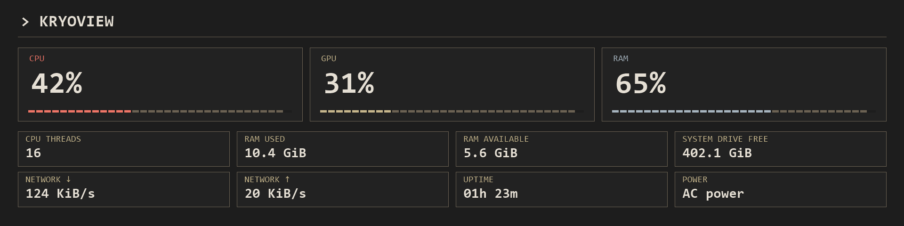

# KryoView

KryoView is an independent Windows 11 x64 utility for a TURZX 8.8-inch USB V1.x panel. The project was vibe-coded with AI assistance and iterated using hands-on feedback from the connected panel.

Hardware validation covers one TURZX 8.8-inch USB V1.x unit connected via USB (VID `1CBE`, PID `0088`). Sensors, USB monitor mode, and switching back to Sensors were confirmed on that unit. Other hardware revisions, panel models, and Windows versions remain unverified.

Closing the window keeps KryoView in the notification area. Select **Exit** there to stop it.

## Dashboard previews

KryoView rendered these previews using sample readings.

## Build

Run `powershell.exe -NoProfile -ExecutionPolicy Bypass -File .\build.ps1` from the project root. The build uses the .NET Framework compiler included with Windows and creates `bin\KryoView.exe`. Run `KryoView.exe --self-test` to check the USB packet, device enumeration, and frame dimensions.

## Test with a panel

1. Connect a TURZX 8.8-inch USB V1.x panel and select **Sensors**. Choose a landscape or portrait layout under **Options → Orientation**. Both layouts offer flipped variants. The dashboard shows CPU, GPU, RAM, CPU threads, used and available RAM, free space on the system drive, inbound and outbound network traffic, uptime, and power status. Readings appear on the panel. GPU usage reflects the busiest GPU engine exposed by Windows. A dash indicates an unavailable reading.
2. For monitor mode, select **Install TURZX display driver** from the notification area menu and choose the INF from the official desktop driver package. Extract all files together, including the signed catalog. Windows requests administrator privileges to install the package with PnPUtil. Obtain the driver package from the manufacturer.
3. Select **USB monitor**, then open **Display settings** to choose **Extend** and set the monitor orientation.
4. Select **Sensors** to return to the dashboard. KryoView sends the HID command after the device confirms that it is an 8.8-inch panel.

KryoView detects Rev C panels. Monitor mode requires the manufacturer's display driver and can run with the TURZX app closed.

## Sensor themes and logs

Open **Sensor themes** to choose a dashboard. Touge Night uses a retro instrument cluster, Prism Original, Snow, and Ink share a gauge layout in three palettes, and Clean Dark HUD uses monochrome cards. Classic and the three terminal themes are also available.

To add a theme, copy a `.theme` file in the `themes` folder next to the executable, then edit it. The first line is the display name, followed by seven `#RRGGBB` colors in this order: background, card surface, border, foreground, CPU, GPU, and RAM. The optional ninth line selects `Terminal`, `Instrument`, `Touge`, or `Clean`. Remove the file to remove its menu entry. If a saved theme is absent at startup, KryoView opens with Classic.

**Hide USB packet transfers** filters the terminal while keeping status messages and errors visible. Clear the checkbox to show recent packet timings again.

### Experimental video backgrounds

Choose **Sensor themes → Choose video background** to loop an Annex B H.264 elementary stream behind any dashboard. Use a clip encoded at 25 FPS and prepared for the panel's native 480 × 1920 frame orientation. Select **Use theme background** to restore the theme's default. A theme can also specify its own clip by adding the local `.h264` filename as the tenth line and placing the clip in the `themes` folder.

KryoView streams H.264 to the device and sends the sensor layer as a transparent PNG. Static dashboards continue to use JPEG. The streaming commands and overlay need validation on the physical unit. The file picker accepts raw H.264 streams.

### Importing TURZX themes

Choose **Sensor themes → Import TURZX theme** and select an 8.8-inch `.turtheme`. The converter requires PowerShell 7 and a compatible .NET Desktop Runtime exposing `System.Formats.Nrbf`. It reads theme records as data and converts supported embedded PNGs, text, bars, and arcs into a KryoView layout. The import stores files under `%LOCALAPPDATA%\KryoView\themes`.

CPU and GPU model labels come from Windows. CPU, GPU, and RAM utilization, disk utilization, memory, network rates, and calendar widgets use live local data. Unsupported readings appear as a dash or an empty gauge. Video references and unsupported widget types are skipped. Original fonts are used when installed, with Windows font fallback otherwise. Some vendor styling, including gradients and segmented gauges, is approximated.

For custom labels, choose **Edit imported labels**, edit the `label` attributes in `layout.xml`, save, and select the imported theme again to reload it.

## License

KryoView is released under the [MIT License](LICENSE). Retain the copyright and permission notices in all copies or substantial portions of the software.

[Panel protocol](https://github.com/jripper77/bezel-evo/blob/windows-improvements/docs/reverse-engineering/protocol-turing-usb.md#10-desktop-mode-and-the-hid-companion-1a86ad11) · [Managing driver packages with PnPUtil](https://learn.microsoft.com/en-us/windows-hardware/drivers/devtest/pnputil-command-syntax)
